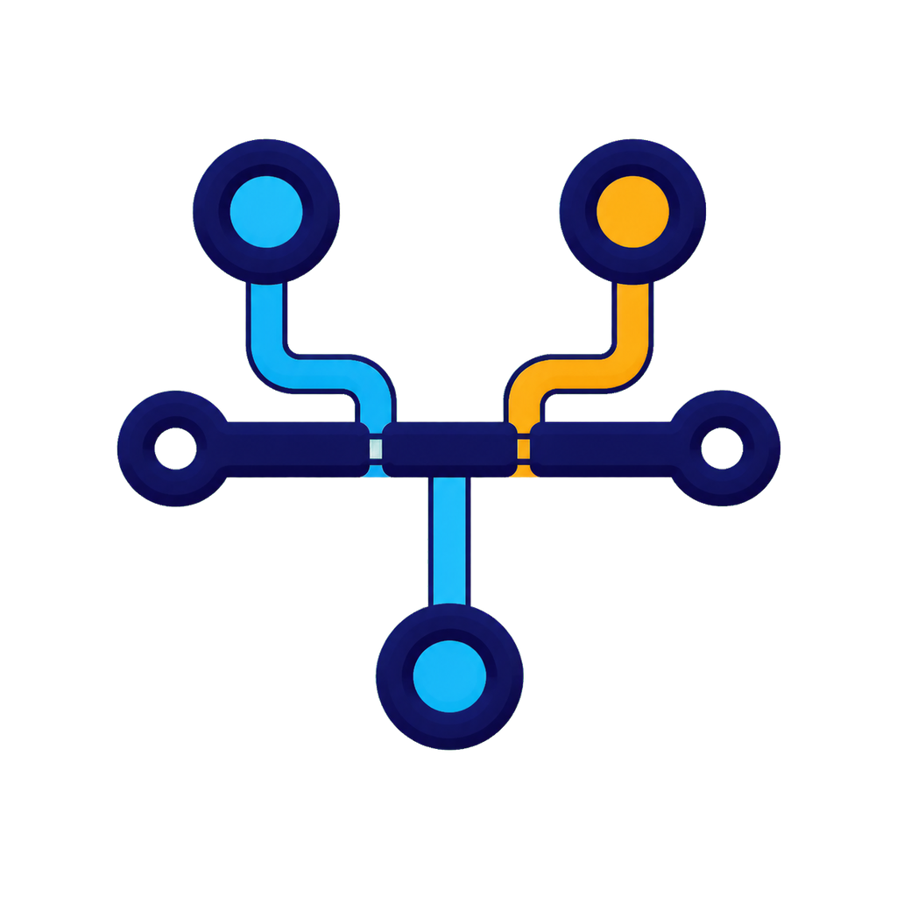

# VibeBus



VibeBus is a local, structured **fact bus** for independent coding-agent tasks. Tasks keep their own conversations and worktrees while sharing only explicit facts — messages, acknowledgements, task state, decisions, path reservations, artifacts, and bounded Git or test results — through a project-scoped SQLite database.

No daemon, no cloud, no transcript sharing. One small Rust binary, one database per project, and 58 MCP tools your agents can call directly.

## Why VibeBus

Coding agents are powerful but isolated: each Codex, Claude Code, Cursor, OpenCode, or Antigravity task owns its own context, and coordinating them means either copying entire conversations (context pollution, privacy loss) or inventing ad-hoc file formats (no atomicity, no audit trail).

VibeBus sits between them as the **durable source of coordination truth**:

- **Atomic task claims** — exactly one agent can win a competing task.
- **Directed inboxes with ACK/close** — facts go only to named recipients, with receipts.
- **Path reservations** — agents declare which files they will touch, and overlap conflicts.
- **Replay-safe event subscriptions** — at-least-once delivery with idempotent ACK.
- **Operator-approved destructive maintenance** — retention and compaction require a human at a real terminal.

## Features

- **Rust CLI + stdio MCP server** (`vibebus mcp`, 58 `vibebus_*` tools) — one binary, one domain model.
- **Per-tool adapters** for Codex, Claude Code, Cursor, OpenCode, and Antigravity — same bus, same skill, per-agent wiring. See [Multi-tool adapters](docs/multi-tool-adapters.md).
- **OS-vault credentials** — Windows Credential Manager and macOS Keychain; SQLite stores digests only.
- **Strict responsibility policy** — `.vibebus/responsibility.json` maps roles to validated project-relative paths, with task-scoped expiring overrides.
- **Immutable facts** — confirmed decisions, Git commit facts, and test-result facts replay exactly and conflict on drift.
- **Agent spawn bridge** — derive `codex`/`claude`/`gemini`/custom CLIs as tracked sessions with bidirectional reply.
- **API provider injection** — project-scoped provider metadata in `.vibebus/api.json`, keys in the OS vault, injected into spawned agents. Zero by default.
- **Capability registry** — `providers`, `skills`, and `plugins` tables for cross-agent capability reuse.
- **Bounded context sync** — deterministic, budgeted, paginated projections per task scope.
- **Lifecycle Hooks** — SessionStart / PostToolUse / Stop capture bounded Git/test facts automatically on Windows and macOS.
- **Native Windows, macOS, and Linux** — Windows and macOS natively; Linux through the `amd64` container workflow.

## Quick start

### 1. Install

From a release: download the source archive and verify it per [docs/release.md](docs/release.md), then build with Rust 1.97.1. Or install the Codex plugin from this repository:

```powershell
# Windows
./scripts/package-plugin.ps1
codex plugin marketplace add .
codex plugin add vibebus@vibebus-local
```

```sh
# macOS (Apple Silicon)
./scripts/package-plugin-macos.sh
codex plugin marketplace add "$PWD/dist/staging/VibeBus-0.11.0-macos-arm64"
codex plugin add vibebus@vibebus-local
```

### 2. Initialize a project

```sh
vibebus init --root /path/to/project --name "My Project"
vibebus register --root /path/to/project --name implementation --role implementation --store-credentials
vibebus credential status --root /path/to/project --agent implementation
```

`register` returns a bearer token and a single-use recovery key in plaintext **once**. With `--store-credentials` they go into your OS vault and the response is redacted (`secretsRedacted=true`).

### 3. Coordinate tasks

Each agent task loads the `vibebus-coordination` Skill and then:

1. `vibebus_status` / `vibebus_handoff_snapshot` — inspect project state and any pending handoff.
2. `vibebus_task_claim` a ready task; treat a claim conflict as proof another task won.
3. `vibebus_reserve` the exact project-relative paths before editing.
4. `vibebus_inbox` → act → `vibebus_ack` → `vibebus_close` for required messages.
5. `vibebus_context_sync` for the deterministic task-scoped projection.
6. `vibebus_handoff_send` with summary, decisions, and artifact references when handing off.

## Core concepts

| Concept | Meaning |
| --- | --- |
| **Agent** | A named identity with bearer/recovery credentials, scoped to one project. |
| **Task** | An atomic unit of work: `pending → ready → claimed → working → ... → completed/abandoned`. |
| **Message** | A directed structured fact to named recipients, with read/ACK/close receipts. |
| **Reservation** | TTL-backed intent on a project-relative path; overlap between different agents conflicts. |
| **Artifact** | A published file reference with SHA-256, type, summary, and JSON metadata. |
| **Decision** | An immutable confirmed fact with a stable semantic key. |
| **Subscription** | An agent-owned event cursor with replay-safe peek/ACK delivery. |
| **Handoff** | A high-priority, ACK-required transfer with summary, decisions, artifacts, and next actions. |
| **Operator** | A separate human-only capability for retention approval and offline compaction. |

## CLI and MCP surface

One binary, two interfaces with identical domain models. CLI responses are JSON; MCP tools return formatted JSON as text content. The full capability tables (identity, messages, tasks, threads, reservations, artifacts, decisions, facts, context, events, subscriptions, retention, compaction, handoffs, spawn, API injection, capability registry) are in [docs/protocol.md](docs/protocol.md).

```sh
vibebus init | register | agents | agent recover | credential status
vibebus send | inbox | read | ack | close
vibebus task create|claim|update|complete|show|list
vibebus thread bind|unbind|list
vibebus reserve add|renew|release|list
vibebus artifact publish|list
vibebus decision confirm | context sync
vibebus fact git-commit | fact test-result
vibebus event list | subscription create|list|poll|peek|ack
vibebus retention plan|apply|status
vibebus maintenance compact --backup <path>
vibebus handoff send|snapshot|propose
vibebus agent spawn | api provider|use|unuse|restore|health|run|key
vibebus skill register|list|install | plugin list
vibebus status | doctor | backup | mcp
```

MCP tools require the absolute project root as `root` on every call when launched from a plugin. See [docs/protocol.md](docs/protocol.md) for the MCP tool names.

## Repository layout

```text
src/              Rust CLI + MCP server (store, mcp, spawn, inject, hooks, vault, policy, ...)
plugins/          Per-tool adapter packages (vibebus/Codex, claude-code, cursor, opencode, antigravity)
scripts/          Packaging, validation, and acceptance scripts (PowerShell + shell + Python)
docs/             Architecture, protocol, release, platform, and operating documentation
tests/            Integration test suites (CLI workflows, core workflows, MCP protocol, vault)
```

## Releases

GitHub Releases are the only official distribution channel. A stable release is a `vX.Y.Z` tag whose commit is reachable from `main`; ordinary branches, pull-request artifacts, and local builds are not releases. SemVer is used for release versions:

- patch releases fix compatible behavior;
- minor releases add backwards-compatible capabilities;
- major releases may introduce incompatible changes and include migration guidance.

Stable releases are currently source-only. GitHub automatically provides the tagged Source code ZIP and tarball; the workflow uploads exactly `SHA256SUMS.txt`, a normalized CycloneDX SBOM, `supply-chain-evidence.json`, and `source-release-manifest.json`. The checksum file covers the other three uploaded evidence files. There are no MSI, portable ZIP, Codex plugin ZIP, signed executable, or installer assets in this first release. macOS, Windows, and Linux remain source and CI-supported paths until a later, separately reviewed binary-distribution contract is adopted. Release candidates are not currently published: tags such as `vX.Y.Z-rc.N` fail closed rather than being treated as stable releases.

To verify a downloaded stable release, download the GitHub-generated source archive and the four uploaded evidence files from the same GitHub Release. Check that the manifest's tag and source revision identify the source archive, then verify `SHA256SUMS.txt` against its three listed evidence files. This source-only release has no installation, signature, upgrade, or binary rollback claim.

Detailed maintainer and verifier instructions are in [docs/release.md](docs/release.md).

## Development

The repository pins Rust `1.97.1`. Run the checks that match the files you change:

```sh
cargo fmt --all -- --check
cargo test --all-targets --locked
cargo clippy --all-targets --all-features --locked -- -D warnings
python3 scripts/normalize-cyclonedx.py --self-test
git diff --check
```

Windows packaging and MSI validation require Windows tooling:

```powershell
./scripts/build-release.ps1
$msi = Get-ChildItem ./dist/VibeBus-*-windows-x64.msi | Select-Object -First 1
./scripts/test-installer.ps1 -MsiPath $msi.FullName
```

See [CONTRIBUTING.md](CONTRIBUTING.md) for contribution expectations, [SECURITY.md](SECURITY.md) for private vulnerability reporting, and [CODE_OF_CONDUCT.md](CODE_OF_CONDUCT.md) for community standards.

## Security and operating boundaries

- Agent credentials belong in Windows Credential Manager or macOS Keychain; never commit tokens, recovery keys, signing material, databases, or generated release assets.
- The Operator lifecycle and destructive maintenance require a real interactive terminal; those actions are intentionally unavailable through MCP.
- VibeBus records durable facts but does not wake, interrupt, merge, or otherwise control native Codex tasks.
- Replay-safe subscriptions are at-least-once deliveries. Consumers must make side effects idempotent.
- API provider keys live only in the OS vault; `api.json`, logs, and MCP responses carry variable names and presence, never key values.

## Documentation

- [Architecture](docs/architecture.md)
- [CLI and MCP protocol](docs/protocol.md)
- [Multi-tool adapters](docs/multi-tool-adapters.md)
- [Design research and decisions](docs/design-research.md)
- [Backup, export, and restore](docs/backup-restore.md)
- [Release engineering](docs/release.md)
- [macOS development](docs/macos.md)
- [Container development](docs/container.md)
- [Maintainer handoff](docs/HANDOFF.md)

VibeBus is released under the [MIT License](LICENSE).
