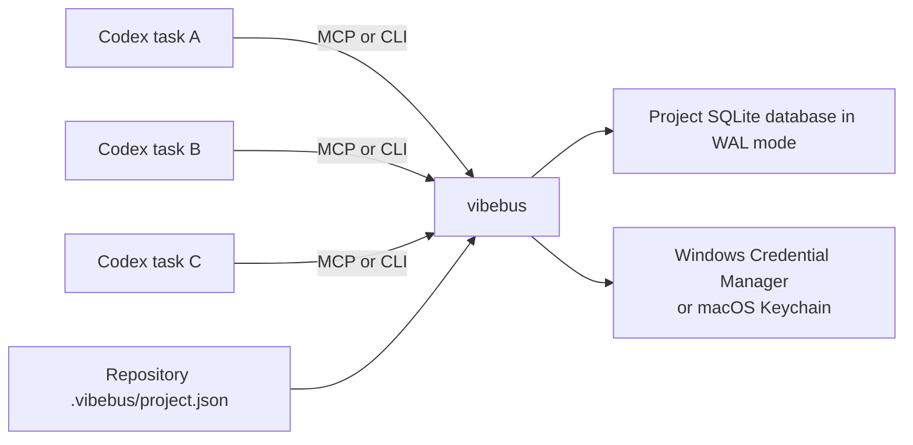

# VibeBus 架构

## 目标

VibeBus 协调独立编码智能体任务（Codex、Claude Code、Cursor、OpenCode、Antigravity），同时不破坏其对话或工作树隔离。共享层仅包含持久事实：可恢复的智能体身份、定向消息、回执、任务、任务/线程关联、依赖、责任覆盖、路径预留、制品、已确认决策、Git/测试事实、订阅与审计事件。各工具的接线方式见 [多工具适配器](multi-tool-adapters.md)。

## 运行时形态



不存在常驻 HTTP 守护进程。每次 CLI 调用或 MCP 进程打开同一个项目数据库。SQLite `BEGIN IMMEDIATE`、唯一约束、乐观版本号与忙等待超时构成协调边界。

## 项目身份与存储

仓库标记刻意保持小巧、易于提交：

```json
{
  "projectId": "prj_...",
  "name": "Example",
  "createdAt": "...",
  "schemaVersion": 1
}
```

数据库默认位于仓库之外：

```text
%LOCALAPPDATA%\VibeBus\projects\<project-id>\vibebus.db
~/Library/Application Support/dev.VibeBus.VibeBus/projects/<project-id>/vibebus.db
```

`VIBEBUS_DATA_HOME` 或 `--data-home` 可覆盖基础目录，用于测试与受控部署。

持有者令牌与恢复密钥始终不进入该数据库。显式请求存储时，Windows 凭据管理器或 macOS 钥匙串为每个项目/智能体目标接收一条当前用户条目：

```text
VibeBus:<project-id>:<agent-name>
```

破坏性维护使用独立的项目操作员目标：

```text
VibeBusOperator:<project-id>
```

操作员刻意不是智能体角色。其仅限 CLI 的交互式能力在短窗口内批准单个精确留存计划，并直接授权经显式确认的离线压缩。MCP 可以规划并执行逻辑留存，但不能初始化、轮换、恢复、删除、批准或压缩。

序列化的密钥对包含格式版本与令牌代数。在 Windows 上它保持在 2,560 字节 Generic Credential BLOB 限制之内，`CRED_PERSIST_LOCAL_MACHINE` 使其对同一 Windows 用户后续本地登录会话可用。在 macOS 上它是 Security.framework 以账号 `VibeBus` 存储的通用密码值。两个后端都不会让其他用户或机器获得凭据。

## 数据模型

| 表 | 用途 |
| --- | --- |
| `projects` | 已解析的项目身份与根目录 |
| `agents` | 名称、角色、持有者/恢复摘要、令牌代数、活跃时间戳 |
| `messages` | 定向结构化事实 |
| `message_receipts` | 每收件人的已投递/已读/ACK/已关闭状态 |
| `tasks` | 所有者、状态、版本、阻塞项、时间戳 |
| `task_dependencies` | 前置依赖边 |
| `task_thread_bindings` | 任务到 Codex 线程的历史关联与解绑时间 |
| `reservations` | 基于 TTL 的路径意图，可选关联任务 |
| `responsibility_overrides` | 所有者签发的、针对一名受让人的限时任务/路径授权 |
| `artifacts` | 文件路径、哈希、摘要、任务关联、元数据 |
| `decisions` | 不可变的任务级已确认事实、语义键、制品引用与作者/时间戳证据 |
| `git_commit_facts` | 不可变的任务/提交关联、有界变更路径、作者与摘要 |
| `test_result_facts` | 不可变的任务/结果键关联、结果、有界命令/摘要与可选报告制品 |
| `idempotency_records` | 操作级请求哈希与缓存响应 |
| `subscriptions` | 智能体拥有的过滤器、已提交游标、待投递与最近 ACK 状态 |
| `events` | 追加式审计事实 |
| `retention_state` | 留存事件历史下限与最近应用的计划 |
| `retention_runs` | 以确认计划为键的可重试不可变清理报告 |
| `operator_credentials` | 项目操作员密钥摘要、代数与轮换时间戳 |
| `retention_approvals` | 短时计划批准、代数绑定与原子消费审计 |
| `providers` | 从 `.vibebus/api.json` 同步的 API 提供方（仅元数据；密钥存于 OS 保险库） |
| `skills` | 已注册的 SKILL.md 能力，含版本、支持的智能体与依赖 |
| `plugins` | 已注册的适配器包，含 MCP 服务、Hook 与引用的技能 |
| `schema_migrations` | 已应用的数据库模式版本 |

## 不变量

1. 消息只出现在显式指定的收件人收件箱中。
2. 恰好一个并发认领者可以拥有一个可认领任务。
3. 任务更新必须同时具备所有者身份与当前版本。
4. 依赖完成后，符合条件的状态待处理任务变为就绪。
5. 终态任务不能回到活跃状态。
6. 不同所有者持有的互斥重叠路径预留相互冲突。
7. 预留路径在语法上不能逃逸项目。
8. 制品路径必须解析为规范项目根目录内的现有文件。
9. 创建备份绝不覆盖已存在的目标。
10. 成功的智能体恢复同时轮换持有者令牌与一次性恢复密钥。
11. 幂等键要么返回原始响应，要么在载荷漂移时冲突。
12. 订阅至多有一个待投递的可重放交付；其已提交游标仅在匹配的 ACK 后前进。
13. 结构化交接是定向、高优先级且标记为需要确认的。
14. 传统轮询式消费不能越过未确认的可重放交付。
15. 需要确认的消息在收件人 ACK 之前不能关闭。
16. 已关闭消息是不可变的回执历史，并从普通收件箱隐藏。
17. 一个任务至多有一个活跃的 Codex 线程绑定，仅由任务所有者管理。
18. 已完成或已放弃的任务没有活跃线程绑定；终态转换原子地结束绑定。
19. 事件留存仅删除早于策略、低于最慢订阅游标且位于配置的近期尾部之外的连续前缀。
20. 待投递的订阅交付受到保护，因为其已提交游标在匹配 ACK 前无法前进。
21. 留存应用要求预览计划未改变；同一已确认计划可重试而不会重复删除。
22. 已关闭消息不能在可能仍引用它们的消息幂等响应过期前过期。
23. 凭据目标按项目 ID 与经校验的智能体名称双重限定，因此不同项目中同名的身份不会冲突。
24. 成功的已存储密钥交付省略持有者与恢复值；旋转后写入失败时，返回唯一可用的一对并附显式存储错误，而不是使身份孤立。
25. 显式令牌输入优先于环境输入，环境输入优先于当前用户保险库回退；恢复密钥回退只来自匹配的保险库条目。
26. 操作员变更仅限 CLI、需要真实终端加精确键入确认，且没有 MCP 工具。
27. 新的留存运行要求一个未过期、未消费的批准，且须绑定精确计划与当前操作员代数。
28. 批准消费、留存删除、审计追加与不可变报告存储原子提交；已完成的重试无需第二个批准。
29. 已确认决策键在全项目范围内标识一个不可变语义载荷；精确重试返回该事实，载荷漂移冲突。
30. 只有非终态任务的所有者可以为其确认决策，且引用的任务级制品不能属于其他任务。
31. 智能体上下文同步仅包含活跃的已拥有任务、其直接依赖、未读定向消息、与该范围相关的制品及与该范围相关的已确认决策。
32. 上下文分页使用确定性事实键而非数据库偏移；每个返回页都同时遵守条目上限与序列化条目字节预算。
33. 已配置的责任策略是严格且失败即关闭的；策略缺失时为既有项目保留 0.10 之前的允许一切行为。
34. 任务级预留、任务制品声明与 Git 变更路径事实必须匹配已验证智能体的角色或一个活跃的任务级覆盖。
35. 只有非终态任务所有者可以授予 60–86,400 秒的已验证责任覆盖；它绝不绕过预留重叠或任务所有权。
36. 任务/提交 SHA 与任务/测试结果键各自标识一个不可变语义载荷；精确重试重放，漂移冲突。
37. 生命周期 Hook 绝不把 shell 输出、转录、差异或日志当作持久事实载荷；未知退出状态被跳过而非猜测。
38. Stop 只生成有界提案。发送交接仍是显式验证操作。
39. 离线压缩仅限 CLI，在正常 `Bus::open` 之前启动，需要 `compact:<project-id>` 加保险库支持的 Operator 密钥，并拒绝非终态任务、活跃绑定、活跃预留、忙 SQLite 边界、已存在的备份路径、未验证的备份或数据库卷剩余空间不足。
40. 压缩在 `VACUUM` 前创建并验证一致性备份，在将 WAL 切换为 DELETE 时保持排他锁，随后恢复并检查点 WAL，验证完整性/外键/模式，并追加有界开始/完成审计事件而不暴露 Operator 密钥。
41. 派生会话在桥接层有界且无状态：子进程在 1,800 秒默认超时下运行，其输出被摘要化（至多 4,000 字符）并按 `[RESULT]` / `[QUESTION]` / `[ERROR]` 标记分类，每个持久结果都以任务、线程绑定与消息形式写回总线。
42. API 提供方注入默认零注入：未配置提供方时，派生环境与基线逐字节一致；提供方环境绝不覆盖显式 profile 环境；`CI=1` 总是最后追加。提供方元数据可出现在磁盘上，但 API 密钥值绝不出现——它只存于 OS 保险库并在进程启动时解析。
43. API 激活是冲突检查且写前备份的：`api use` 在未带 `--force` 时拒绝覆盖冲突的系统环境变量，在变更前快照既有配置（最新 10 份备份），并记录 `api.provider_activated` / `api.provider_deactivated` / `api.config_restored` 审计事件，其载荷仅携带变量名。
44. 能力注册表是项目级且声明式的：`providers`、`skills`、`plugins` 每项目唯一，注册是可查询事实，`skill install` 只写入目标智能体 CLI 的技能目录，不修改用户级全局配置。

## 恢复与重试边界

持有者令牌与恢复密钥由独立的随机 UUID 材料生成，在 SQLite 中仅以 SHA-256 摘要存储。恢复是凭据轮换而非身份重建：任务所有权、消息、订阅、预留与制品仍附着在同一智能体行。传统智能体可以使用仍有效的持有者令牌为其首次恢复密钥建档。

凭据保险库层位于领域事务之外。注册、恢复与建档先提交权威摘要状态，再将返回的一对写入 OS 保险库。成功后响应被脱敏。若第二次写入失败，隐藏密钥会使新提交的身份无法恢复，因此响应刻意回退为明文对加 `credentialStorageError` 与 `secretsRedacted=false`。当恢复或建档本身使用了保险库密钥时，轮换后的一对自动写回，使一次性恢复密钥不会过期。

Windows 后端直接调用 `CredWriteW`、`CredReadW`、`CredDeleteW` 与 `CredFree`。macOS 后端使用 Security.framework 的通用密码设置/获取/删除操作，将缺失项映射为正常的不存在状态，并抑制交互式认证 UI，使 CLI、MCP 服务或 Hook 在其代码签名未获授权访问旧条目时失败关闭而非挂起。单元测试注入内存实现；仓库的 macOS 验收夹具单独创建并移除一次性真实 Keychain 条目。保险库是静态存储与意外泄露边界，而非已在同一 OS 用户下运行的进程之间的沙箱。

操作员初始化与轮换使用与智能体凭据相同的摘要优先/保险库其次恢复规则。成功存储会脱敏操作员密钥。若保险库写入在权威代数变更后失败，交互式响应会一次性暴露唯一可用密钥并附显式错误。`operator restore-credential` 通过无回显 TTY 提示接受该密钥，对照数据库摘要验证，并修复独立的保险库条目。操作员轮换会使上一代的所有未决批准失效，但不删除其审计记录。显式 `operator delete-credential` 在真实终端 `delete:<project-id>` 确认后仅移除当前用户保险库条目。它刻意保留数据库摘要与代数，导致 `ready=false`；这支持可验证的一次性项目清理，而无需新增远程或 MCP 删除能力。

外部重试写入在同一个 `BEGIN IMMEDIATE` 事务中记录规范 JSON 请求哈希与序列化响应，与领域变更一起提交。这防止常见的歧义结果重试创建重复消息、租约、续期、制品或决策。记录刻意按操作限定，因此不相关 API 可以复用调用方的键。已确认决策通过其唯一的项目/键对保留第二层持久语义去重边界，即使通用幂等记录过期。在显式配置的幂等保留窗口过期后，其他操作的历史请求键保证也随之过期；清理计划报告受影响的记录数。

## 智能体上下文投影

`context sync` 是已认证的任务特定读模型。它从智能体的活跃已拥有任务开始，恰好展开一条依赖边，然后选择与该任务范围关联的未读定向消息、制品、不可变已确认决策、Git 提交事实与测试结果事实。它绝不返回无关任务、项目级全局事件历史、制品元数据 blob、制品文件内容、差异或测试日志。已 ACK、已读或已关闭的消息离开默认投影，因为其回执状态在上下文页之外保持持久。

每个投影事实都有确定性的类别/顺序键。续接游标编码最后发出的键，因此静态分页不会重复或跳过事实，也不依赖可变 SQL 偏移。并发状态变更可以增删后续事实；调用方在需要全新原子视图时应从头重启，而不要把游标当作数据库快照。

调用方提供条目与序列化条目字节预算。任务描述、阻塞项、消息体与制品摘要是带显式截断标志的有界预览。决策摘要在确认时被有界化，而长证据留在制品 ID/路径/哈希引用之后。响应报告精确消耗的条目字节数、是否还有更多事实，以及仅在需要续接时返回下一个游标。

## 事件消费

每个领域变更在同一事务中追加一个项目事件。整数 `sequence` 是规范排序游标。直接事件查询是无状态且可从调用方保留的游标重放的。

命名订阅在 SQLite 中维护已认证的智能体拥有已提交游标。可重放 peek 写入一个待投递范围而不移动该游标；重复 peek 重建同一不可变事件范围。ACK 原子地移动游标，记录最近已确认投递以支持重试恢复，并清除待处理状态。游标簿记刻意不再追加事件，避免通配订阅的无限自通知循环。

传统轮询仍一次调用内消费并提交，但每当存在待投递状态时冲突。未来留存绝不能删除任何待投递范围内的事件。关键载荷（如交接）在定向收件箱中独立持久，因此事件投递是通知/索引状态，而非工作指令的唯一副本。

## 消息与任务/线程生命周期

消息关闭是收件人拥有的终态回执操作。关闭同时记录已读状态。标记为 `requiresAck` 的消息必须先 ACK；成功关闭是可重试的，并恰好追加一个 `message_closed` 事件。默认收件箱排除已关闭消息，而显式历史读取可以包含它们。

任务所有者可以将非终态任务绑定到一个调用方提供的 Codex 任务/线程标识符。重复同一绑定或解绑返回原绑定状态；尝试第二个活跃标识符冲突。VibeBus 只存储关联——它不调用 Codex 线程 API。将任务移至 `completed` 或 `abandoned` 会原子地关闭其活跃绑定，因此恢复快照不会宣称过期的执行所有权。

## 有界留存

留存是显式三关卡操作。已认证智能体预览计算截止点与精确候选数，然后将策略、当前事件尾部、订阅保护边界、留存历史下限与候选集哈希为 `planId`。本地操作员审阅并在 60–3,600 秒窗口内以交互方式授权该精确 ID。应用打开 `BEGIN IMMEDIATE`，重新计算计划，要求当前操作员代数下存在活跃批准，并在删除前拒绝过期或未批准的工作。批准簿记刻意不追加领域事件，因为那会使它自身的计划失效。

被接受的批准在同一事务中与删除、`retention_applied` 事件与不可变运行报告一起被消费。并发尝试串行化；一方提交后，另一方看到并重放存储的报告。这种歧义结果恢复路径不需要第二个批准，也不能执行两次删除。

事件仅作为连续前缀被裁剪。计划边界是年龄边界、最慢已提交订阅游标与配置的近期事件尾部前一序号的最小值。因此游标为 `0` 的订阅会阻止事件删除；未确认的待投递交付保持相同保护直到 ACK。每次成功清理在删除后追加新的 `retention_applied` 审计事件并推进持久历史下限。早于该下限的事件查询或刻意订阅重放会冲突而非静默返回不完整历史；压缩交接快照会钳制到可用下限。

其他清理域独立且按年龄有界：幂等记录、已关闭的每收件人回执、无回执的遗留消息以及终态任务的未绑定历史。活跃消息、活跃任务绑定、非终态任务历史、订阅、任务、制品、已确认决策、智能体、预留、留存报告与模式记录不被移除。逻辑留存绝不自动运行 `VACUUM`；物理压缩是下面单独确认的离线操作。

## 离线压缩

`maintenance compact --backup <new-path>` 刻意不在 MCP 中提供，并在正常连接/迁移路径之前处理。维护者必须停止该项目的所有 CLI、MCP、Hook 与 Codex 任务，在真实终端键入 `compact:<project-id>`，并在平台保险库中持有当前 Operator 凭据。核心随后以读/写方式打开既有数据库而不创建或迁移它，设置零忙等待超时，检查点 WAL，保持排他锁，切换到 DELETE 日志模式，验证当前模式/项目/Operator 身份，并拒绝任何非终态任务、活跃任务绑定或未过期预留。

在 `VACUUM` 之前，VibeBus 创建一个不覆盖的新 SQLite 备份，验证其完整性、外键、模式与项目身份，并要求活动数据库旁至少有两倍当前数据库大小的空闲空间。它在排他边界下记录有界开始事件、运行 `VACUUM`、恢复 WAL、记录完成、检查点，并返回前后文件哈希、大小、页/空闲页计数、回收字节、备份身份、Operator 代数与最终验证。日志切换后失败时尽力恢复 WAL；已验证备份仍是恢复边界。仓库验收仅针对一次性项目/数据目录调用核心，绝不针对活动协调数据库。

## 插件生命周期（Codex 适配器）

Codex 适配器（`plugins/vibebus/`）是规范插件包。`plugins/` 下的同级目录提供 Claude Code、Cursor、OpenCode 与 Antigravity 适配器；见 [多工具适配器](multi-tool-adapters.md)。Codex 插件包含：

- `.mcp.json`，用打包的原生可执行文件以 `mcp` 启动；
- `skills/vibebus-coordination/SKILL.md`，定义与工具无关的协调纪律；
- `hooks/hooks.json`，在 Windows 上运行 PowerShell 实现，在 macOS/Unix 上运行原生二进制的 SessionStart/PostToolUse/Stop 实现。

MCP 进程从已安装插件目录启动。因此每个 MCP 工具都接受 `root` 参数；技能要求每次调用都提供绝对项目根目录。Hook 命令接收 `PLUGIN_ROOT` 与可写的 `PLUGIN_DATA`，需要 Codex 信任审阅，并在会话工作目录运行。PostToolUse 仅解析活跃任务/线程绑定（匹配原始会话 id 或任何受支持的 `{tool}:{session_id}` 形式）、可靠退出元数据、提交身份/主题/路径名与哈希工作状态；Stop 调用有界提案读模型并将其写入插件数据目录。两个 Hook 都不读取不稳定的转录格式，Stop 不产生续接或自动消息变更。

## 智能体派生桥

`vibebus agent spawn`（以及 `vibebus_agent_spawn`/`vibebus_agent_reply`/`vibebus_agent_kill`/`vibebus_agent_status` MCP 工具）将外部智能体 CLI（`codex`、`claude`、`gemini`、自定义 profile 或内置 `demo` 脚本 profile）派生为可追踪、有界的会话。桥接层不持有业务状态：它创建 VibeBus 任务，绑定派生会话线程，通过行帧 stdin/stdout 协议运行子进程，并在终态结果下记录自消息并完成任务。澄清问题使会话保持存活以供稍后 `reply`。会话被摘要回事实（绝不完整转录），符合无转录非目标。派生子进程继承注入智能体的环境加上任何已配置的 API 提供方环境（见下），且 `CI=1` 最后追加，使交互式提示不会挂起自动化。

## API 提供方注入

项目级 API 提供方让插件向派生智能体 CLI 注入 Base URL、API 密钥与可选模型，而无需编辑用户全局配置。提供方元数据存于 `.vibebus/api.json`；API 密钥只存于 `VibeBusApi:<project-id>:<provider>` 下的 OS 凭据保险库。`api use`/`api unuse`/`api restore` 预先写入备份（最新 10 份）、生成在源码解析时从保险库取密钥的环境导出文件（`env.sh`/`env.ps1`），并追加 `api.provider_activated`/`api.provider_deactivated`/`api.config_restored` 审计事件，仅携带变量名。`api health` 本地校验配置、保险库密钥存在性与 URL 形状，并提供可选 TCP 网络探测。注入默认零注入，密钥绝不落盘、入日志或入 MCP 响应。

## 能力注册表

`providers`、`skills`、`plugins` 三表构成项目级能力注册表。`api sync-providers` 将 `.vibebus/api.json` 提供方 upsert 进总线；`skill register` 存储带版本、支持智能体与依赖声明的 SKILL.md；`skill install --agent <cli>` 将其复制到匹配智能体的技能目录；`plugin list` 描述已注册的适配器包。注册表是声明式的：注册是可查询、可审计的事实，同一提供方或技能可在任何受支持编码智能体间复用，而无需复制密钥或文件。

## 发布供应链

Rust 1.97.1 与 Cargo.lock 定义原生构建输入。仓库拥有的 PowerShell 路径打包 Windows、校验 manifest/MCP/Hook/Skill 契约，并使用钉版 WiX 4.0.6 生成每用户 x64 MSI。macOS 路径构建原生主机架构 Mach-O、应用临时（ad-hoc）本地签名、暂存 macOS MCP 载荷、校验它，并生成便携/插件归档加校验和与 manifest。Developer ID 签名、加固运行时、公证与下载制品 Gatekeeper 验收仍是显式生产关卡。

PR CI 具有只读仓库权限，并生成显式未签名的短期验收制品。它运行标准 MSI 校验（除无关的仅限每机器 ICE91 规则外），创建管理映像，验证预期载荷与二进制版本，并清理映像。

生产发布自动化是标签门控且失败即关闭的。现有 `vX.Y.Z` 标签必须匹配 Cargo 与插件版本。SignTool 在暂存前对二进制、在构建后对 MSI 使用 SHA-256 与 RFC 3161 时间戳签名并验证。校验和仅在签名后计算。作业级 `GITHUB_TOKEN` 以 `contents: write` 发布资产；签名材料仅存于仓库或受保护环境 Secrets。

## 明确非目标

- 共享完整聊天转录；
- 向已运行的模型生成注入消息；
- 替换 Codex 任务、工作树或原生子智能体；
- 远程多主机同步；
- 自动 Git 合并或冲突解决；
- 在仓库文件中持有密钥；
- 恰好一次消费副作用；可重放交付在 ACK 前是至少一次；
- Linux 安全保险库后端或跨设备凭据恢复；
- 防御已作为同一 OS 用户运行的恶意进程；
- 硬件支持或远程多方操作员批准；当前关卡是本地人类在场与意外自动化边界；
- 自动创建发布标签或未签名生产发布；
- 静默变更 Codex 插件配置的安装器自定义动作；
- 逐位可复现 MSI/ZIP 输出，或在不合格 GitHub 计划上的私有仓库证明；
- 将 API 密钥或恢复密钥写入仓库文件、日志或生成的环境导出（注入仅在启动时从保险库解析密钥）；
- 在未显式选择（如 `--write-config`）时编辑用户全局智能体配置（`.claude/settings.json`、`~/.codex/...`）。
